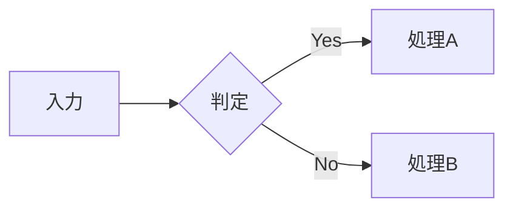

# 画像と図版

:::{.chapter-lead}
技術書の紙面では、スクリーンショットや写真を本文と並べたり、手順の要所に印を付けたり、仕組みを図で示したりする場面が多くあります。本章では、画像の大きさと配置・キャプションと図番号・複数の画像の並べ方を説明し、続いてスクリーンショットへの注釈・mermaid によるダイアグラム・SVG による作図を扱い、最後に参考書籍を紹介するカードを説明します。作りたい紙面に応じて、必要な節から読んでください。
:::

## 画像レイアウト @image-layout

画像ファイルは、章ごとに `images/<章のファイル名>/` へ置きます（`23-figures.md` なら `images/23-figures/`）。原稿にはファイル名だけを書けば、ビルド時にその章のディレクトリから探します。ほかの章の画像を使うときは、`images/11-workflow/logo.webp` のように `images/` から書きます。画像ディレクトリは `vs create` で章を作ると一緒に作られます。

### `{width=… align=…}` — 画像の幅と配置を指定する

画像記法の後ろに `{}` を付けると、紙面での幅と配置を指定できます。幅は本文の幅に対する `%` か、`40mm`・`4em` のような長さで書きます。配置は `left`・`center`・`right` のいずれかです。幅と配置は、片方だけでも書けます。`left` と `right` では、後に続く本文が画像の横に回り込みます。

```markdown
{width=30% align=left}
{width=50%}
{align=right}
```

たとえば次のように、幅 50%・中央寄せで配置してみます。{.aki}

```markdown
{width=50% align=center}
```

:::{.output}
{width=50% align=center}
:::

#### 文中に置いた画像の幅を決める

段落の途中や、箇条書き・表の中に置いた画像にも `width` を指定できます。アイコンのような小さな画像を文字と並べるときは、`em`（本文の文字 1 字分）で指定すると、文字の大きさにそろえやすくなります。

```markdown
設定画面は、歯車のアイコン {width=1em} から開きます。
```

`%` は、その画像を含む段落（表の中ならセル）の幅に対する割合です。幅を指定しないと画像は元の大きさで置かれ、本文の幅を超える画像は本文の幅に縮められます。

#### `border` — 画像の枠を外す・付ける

段落に単独で置いた画像には、既定で細い枠が付きます（SVG の図には付きません）。白い背景のスクリーンショットと、紙面の余白との境目を示すためです。ロゴや透過画像のように枠が要らないときは、`border=off` で外します。

```markdown
{width=30% border=off}
```

文中に置いた画像に枠を付けるときは、`border=on` と書きます。枠の色は、`stylesheets/custom.css` で `--color-figure-border`（既定 `#ccc`）を上書きすると変えられます。

### `** タイトル **` — キャプションと図番号を付ける

画像の直前に `** タイトル **` という独立した行を置くと、その行が画像のキャプションとして表示されます。行頭と行末の `**` は太字ではなく、画像へ結び付くキャプションを示します。

```markdown
** アインシュタインの肖像 **
{width=40% align=center}
```

:::{.output}
** アインシュタインの肖像 **
{width=40% align=center}
:::

さらにタイトルの末尾に `@ラベルID` を付けると、「**図 2-1: アインシュタインの肖像**」のように章番号付きの**図番号**が自動で割り振られ、本文中から `@ラベルID` で参照できるようになります。

```markdown
** アインシュタインの肖像 @einstein-portrait **
{width=40% align=center}
```

:::{.output}
** アインシュタインの肖像 @einstein-portrait **
{width=40% align=center}
:::

本文に `@einstein-portrait` と書くと、@einstein-portrait のように図番号のリンクになります。表やリスト（コード）にも同じ方法で番号を付けられます。詳しくは @chapref:ch-cross-reference を参照してください。

### `.pictures` — 写真グリッド

複数の画像を、同じ幅で横に並べます。画像ごとに幅を指定する必要はありません。1 枚の幅は本文の文字 12 字分を下回らないので、並びきらない画像は次の行へ回ります（A4 判では 1 行に 3 枚まで）。

```markdown
:::{.pictures}


:::
```

::::{.output}
:::{.pictures}


:::
::::

### `.image-group` — 2 枚を横に並べる

2 枚の画像を、同じ幅で横に並べます。1 枚目に `{width=30%}` のように幅を書くと、1 枚目がその幅、2 枚目が残りの幅になります。

```markdown
:::{.image-group}
{width=30%}

:::
```

::::{.output}
:::{.image-group}
{width=30%}

:::
::::

### `.img-text` / `.text-img` — 画像＋本文の横並び

画像と本文を左右に並べます。左右の順と幅の比で、次の六つを使い分けます。

| クラス名 | 左 | 右 | 列比率 |
|---|:---:|:---:|:---:|
| `.img-text`  | 画像 | 本文 | 1:1 |
| `.img-text2` | 画像 | 本文 | 1:2 |
| `.img-text3` | 画像 | 本文 | 1:3 |
| `.text-img`  | 本文 | 画像 | 1:1 |
| `.text2-img` | 本文 | 画像 | 2:1 |
| `.text3-img` | 本文 | 画像 | 3:1 |

```markdown
:::{.img-text2}


アルベルト・アインシュタインは、特殊相対性理論と一般相対性理論を提唱した物理学者です。`.img-text2` では画像と本文が 1:2 の比率で並びます。
:::
```

::::{.output}
:::{.img-text2}


アルベルト・アインシュタインは、特殊相対性理論と一般相対性理論を提唱した物理学者です。`.img-text2` では画像と本文が 1:2 の比率で並びます。
:::
::::

### `.sideimage-right` / `.sideimage-left` — サイドイメージ

本文の横に画像を並べます。`.img-text` と違い、画像の幅を `{width=30%}` のように自由に決められます。幅を書かないときは、画像が 40%、本文が 60% です。`.sideimage-right` は画像を右、`.sideimage-left` は左に置きます（`.sideimage` は `.sideimage-left` と同じです）。

```markdown
:::{.sideimage-right}
アルベルト・アインシュタインは、特殊相対性理論と一般相対性理論を提唱したことで知られる物理学者です。`.sideimage-right` では、本文が左、画像が右に並びます。

{width=30%}
:::
```

::::{.output}
:::{.sideimage-right}
アルベルト・アインシュタインは、特殊相対性理論と一般相対性理論を提唱したことで知られる物理学者です。`.sideimage-right` では、本文が左、画像が右に並びます。

{width=30%}
:::
::::

### `.gap-s` / `.gap-m` / `.gap-l` — 画像と本文の間隔を変える

`.img-text` 系・`.sideimage-*`・`.image-group` に併記すると、画像と本文（または画像どうし）の間隔を変えられます。`.gap-s` は 0.5rem、`.gap-m` は 1rem（指定しないときと同じ）、`.gap-l` は 1.5rem です。

```markdown
:::{.img-text .gap-l}


大きな余白（1.5rem）で配置
:::
```

::::{.output}
:::{.img-text .gap-l}


大きな余白（1.5rem）で配置
:::
::::

## 図解注釈の方法 @showcase-howto

操作手順のスクリーンショットには、ボタンを枠で囲む・矢印で指す・丸数字で本文と対応させるといった注釈を付けます。画像編集ソフトで描き込むと、位置を少し直すたびに画像を書き出し直すことになり、注釈の変更も原稿の履歴に残りません。

`:::{.showcase}` を使うと、注釈を**原稿の中に文字で書けます**。元の画像は変更せず、注釈の種類・位置・大きさを数値で指定します。位置を直すときは数値を書き換えるだけで、変更は原稿と一緒に記録されます。

### 基本の書き方

`:::{.showcase}` ブロックの中に、**画像を 1 枚**と、**注釈行**を並べます。

```markdown
:::{.showcase}
{width=70%}
# 行頭が # の行はコメントです（出力されません）
rect:1 530, 335, 175, 165 {pos=bottom} 愛用のバイオリン
pointer:2 490, 130 {label="白髪"} くしゃくしゃの白髪
:::
```

::::{.output}
:::{.showcase}
{width=70%}
rect:1 530, 335, 175, 165 {pos=bottom} 愛用のバイオリン
pointer:2 490, 130 {label="白髪"} くしゃくしゃの白髪
:::
::::

注釈行は、次の四つの部分をスペースで区切って書きます。

| 部分 | 例 | 意味 |
|---|---|---|
| コマンドと番号 | `rect:1` | 何を描くか。`:1` が丸数字の番号 |
| 座標 | `530, 335, 175, 165` | どこに描くか。カンマ区切り |
| オプション | `{pos=bottom}` | どう描くか。省略可 |
| 著者コメント | `愛用のバイオリン` | **画像には表示されません** |

<!-- no-lint -->
著者コメントには、その注釈が何を示すかを書きます。紙面には表示されませんが、番号を付けた注釈のコメントは「① 愛用のバイオリン ② くしゃくしゃの白髪」のようにまとめられ、画像の代替テキストの後ろに加わります。原稿を直すときの手がかりになり、読み上げソフトや画像を表示できない環境にも注釈の意味が伝わります。

### 座標はパーミルで指定する

座標は画像のピクセル数ではなく、**画像の左上を (0, 0)、右下を (1000, 1000) とする千分率（パーミル）**で指定します。横方向は幅の千分率、縦方向は高さの千分率です。

{width=60% align=center}

縦横比が同じなら、解像度の違う画像に差し替えても、注釈は同じ位置に置かれます。

画像編集ソフトで測った位置は、**`px` を付ければピクセルのまま書けます**。パーミルへの換算はビルドで行います。

```markdown
# どちらでも同じ場所を指す（元画像が 1280 × 768px の場合）
rect:1 530, 335, 175, 165
rect:1 678px, 257px, 224px, 127px
```

:::{.tip}
最初は画面上で測った `px` を使い、配置が決まってからパーミルへ直すと、計算と調整を分けられます。画像を差し替える予定がなければ、`px` のまま残しても構いません。
:::

### `rect` — 対象を枠で囲む

`rect` は、指定した座標から幅・高さの分だけ枠を描きます。

```markdown
rect:[番号] [X], [Y], [幅], [高さ] {オプション} 著者コメント
```

丸数字を枠のどこに置くかは `pos` で決めます。省略すると `left`（枠の左辺）です。

| 指定 | 丸数字の位置 |
|---|---|
| `pos=left` | 枠の左辺の中点（既定） |
| `pos=right` | 枠の右辺の中点 |
| `pos=top` | 枠の上辺の中点 |
| `pos=bottom` | 枠の下辺の中点 |
| `pos=center` | 枠の内部中央 |

枠線は `border` で、塗りつぶしは `background` で変えられます。`border` は CSS と同じ「太さ・線種・色」の書き方で、線種は `solid` / `dashed` / `dotted` が使えます。

```markdown
:::{.showcase}
{width=70%}
rect:1 530, 335, 175, 165 {pos=right}
rect:2 725, 545, 220, 150 {pos=center border="3 dashed #1c7ed6" background="rgba(28,126,214,0.15)"}
:::
```

::::{.output}
:::{.showcase}
{width=70%}
rect:1 530, 335, 175, 165 {pos=right}
rect:2 725, 545, 220, 150 {pos=center border="3 dashed #1c7ed6" background="rgba(28,126,214,0.15)"}
:::
::::

### `pointer` — 対象を指し示す

`pointer` は、ホームベース型の記号の先端で一点を示します。ボタン・アイコン・小さな部品など、枠で囲むほどの広がりがない対象に向いています。

```markdown
pointer:[番号] [X], [Y] {オプション} 著者コメント
```

座標には、記号の左上ではなく、**矢印の先端を置く点**を指定します。記号本体は `dir` の向きに応じて、先端の反対側へ伸びます。ボタンや文字を隠さないよう、対象の中心ではなく**外周**へ先端を置くと読みやすくなります。

:::{.table-text}
| 指定 | 向き | 本体が伸びる方向 |
|---|---|---|
| `dir=right` | ▶ 右向き（既定） | 先端の左側 |
| `dir=left` | ◀ 左向き | 先端の右側 |
| `dir=up` | ▲ 上向き | 先端の下側 |
| `dir=down` | ▼ 下向き | 先端の上側 |

`label` を付けると、本体の中に短い文字を埋め込めます。`:番号` を省略すればラベルだけになり、丸数字は描かれません。
:::

```markdown
:::{.showcase}
{width=70%}
# 番号とラベルの両方（既定の右向き。本体は先端の左へ伸びる）
pointer:1 490, 130 {label="白髪"}
# 下向き（本体は先端の上へ伸びる）
pointer:2 672, 225 {dir=down label="弓"}
# 番号を省略＝ラベルのみ（左向き。本体は先端の右へ伸びる）
pointer 805, 440 {dir=left label="糸巻き"}
:::
```

::::{.output}
:::{.showcase}
{width=70%}
pointer:1 490, 130 {label="白髪"}
pointer:2 672, 225 {dir=down label="弓"}
pointer 805, 440 {dir=left label="糸巻き"}
:::
::::

### `crop` — 画像の周囲を切り落とす

<!-- no-lint -->
画像の余分な周囲は、`crop` で切り落とせます。値は CSS と同じ「上・右・下・左」の時計回りで、1 つ（四辺共通）・2 つ（上下／左右）・3 つ（上／左右／下）・4 つのいずれかで書きます。段落に単独で置いた画像と、`:::{.showcase}` の中の画像に使えます（文中に置いた画像には使えません）。

```markdown
# 上下左右を均等に
{crop="50"}

# 上下 30、左右 100
{crop="30 100"}

# 上 30 / 左右 100 / 下 60
{crop="30 100 60"}

# 上 30 / 右 250 / 下 60 / 左 100（px でも可）
{crop="30 250 60 100"}
```

`crop` を指定しても、**注釈の座標の基準は、切り落とす前の元画像のままです**。注釈を書いた後で切り落とす範囲を変えても、座標を書き直す必要はありません。

```markdown
:::{.showcase}
{width=60% crop="30 250 60 100"}
# crop を追加しても座標はそのまま（元画像基準のため）
rect:1 530, 335, 175, 165 {pos=bottom} 愛用のバイオリン
:::
```

右側の書棚と机が、表示する範囲の外へ出ます。

::::{.output}
:::{.showcase}
{width=60% crop="30 250 60 100"}
rect:1 530, 335, 175, 165 {pos=bottom} 愛用のバイオリン
:::
::::

### `trim=on` — 画像の余白を詰めて大きく載せる

画像の周りに余白があると、その分だけ絵が小さく載ります。`trim=on` を付けると、ビルドで絵の範囲を測り、余白を詰めて載せます。絵の周りには、絵の幅の 2% の余白を残します。

```markdown
{trim=on}
```

`trim=on` は、`crop` の値を自動で測る指定です。画像の四隅の色を背景とみなすので、白・透明・単色の背景の画像に使えます（SVG・PNG・WebP のどれでも使えます。SVG の全面に敷いた背景の四角も背景とみなします）。グラデーションの背景や、スキャンした紙面のように背景の色が一定でない画像は、`crop` で範囲を決めてください。使える場所は `crop` と同じで、両方を書くと `crop` を使います。`images/` の画像は書き換えません。

後の節で説明する SVG の雛形で描いた図には、`trim=on` を付けずに載せます。詰めると余白の多い図ほど拡大され、図ごとに文字の大きさが変わるからです。

`vs build` と `vs preflight` は、絵が画像の幅の 85% に満たない画像を 🟡 で警告し、`{trim=on}` を追加した書き方を示します。余白を意図して残した画像に `{trim=off}` と書くと、その画像は指摘の対象から外れます。

### オプション一覧

`{}` の中には、次のキーをスペース区切りで並べられます。値に空白を含めたいときは `border="3 dashed blue"` のように二重引用符で囲みます。

| キー | 対象 | 説明（かっこ内は既定値） |
|---|---|---|
| `pos` | rect | 丸数字を枠のどこに置くか（`left`） |
| `dir` | pointer | 矢印の向き（`right`） |
| `label` | pointer | 本体に埋め込む文字（なし） |
| `border` | rect | 枠線の太さ・線種・色（`3 solid #ff3b30`） |
| `background` | rect / pointer | 塗りの色（rect は `transparent`、pointer は `#ff3b30`） |
| `color` | 共通 | 数字・ラベルの文字色（rect は濃色、pointer は `white`） |
| `font-size` | 共通 | 文字の大きさ（rect の数字 28、pointer の数字 24・ラベル 30） |

枠線の太さと文字の大きさは、表示する画像の幅を 1000 とした値です。画像側の属性は `width`（既定 `100%`）・`crop`・`trim` の三つです。

普通の画像と同じく、`:::{.showcase}` の直前の行に `** タイトル @ラベルID **` を置くと、キャプションと図番号が付き、本文から `@ラベルID` で参照できます。

### PDF・EPUB・Kindle での見え方

`:::{.showcase}` は、ビルドで元の画像と注釈を 1 枚の画像に合成するので、**PDF・EPUB・Kindle のどれでも同じ見た目**になります。PDF では注釈を図形のまま収録するので、印刷しても線や文字がぼやけません。

:::{.memo}
注釈の合成には ImageMagick と librsvg が必要です。インストールされていないときは、注釈を付けずに画像だけを載せ、警告を表示します。`vs doctor --fix` でインストールできます。
:::

## ダイアグラム（mermaid）

### `mermaid` — フローチャート・シーケンス図など

言語名に `mermaid` を指定したコードフェンスに mermaid の図ソースを書くと、ビルド時に画像へ変換されます。記法は標準の mermaid のままで、**PDF にはベクター形式、EPUB・Kindle にはラスター形式**で収録されます。

````markdown

````

:::{.output}

:::

### 使える図の種類

mermaid の図の種類は、すべて使えます（flowchart / sequenceDiagram / classDiagram / stateDiagram / erDiagram / gantt / pie など）。図ソースの 1 行目に種別を書きます。各図の記法と例は、[Mermaid ドキュメント日本語訳の「ダイアグラム構文」](https://mermaid.dokyumento.jp/intro/syntax-reference.html)を参照してください。

図中の文字は**書籍の見出しの書体で組まれ**、配色は mermaid の `neutral` テーマ（白黒の濃淡）です。曲線の形など mermaid 固有の見た目は、図ソースの `%%{init: …}%%` で指定します。

描画には `mmdc`（`@mermaid-js/mermaid-cli`）が必要で、`vs doctor --fix` でインストールできます。インストールされていないときは、図は**コードブロックのまま載り**、警告を表示します。

## 自分で図版を描く（SVG）

座標系の模式図、構造の対応表、値の推移など、スクリーンショットでは用意できない図は、著者が作図します。その形式には **SVG を使います**。PNG のようなラスター画像と異なり、拡大しても線や文字の輪郭を保てます。図形や文字を数値で記述するため、後から位置や内容を修正しやすいことも、技術書の図版に適しています。

SVG の図版は、PDF と EPUB にベクター形式のまま収録されます。図中の文字は**書籍の書体で組まれ**、図に使った字は書体ごと図に埋め込まれるので、読者の環境に同じ書体がなくても見た目は変わりません。

:::{.note}
Kindle 版では、SVG は画像に変換して収録します。このとき図中の文字は、書籍の書体ではなく、ビルドした PC の書体で描かれます。書籍の書体での見え方は、PDF か EPUB で確かめてください。
:::

### SVG 図版の雛形

次のコードは、SVG 図版を作成するときの雛形です。新しいファイルへコピーし、図形やテキストを置き換えて利用できます。作図ソフトやコード生成ツールを使う場合も、寸法・書体・配色を整えるための参考にしてください。

```svg
<svg xmlns="http://www.w3.org/2000/svg"
     width="100%" viewBox="0 0 648 400" role="img">
  <!-- 幅は版面幅（mm）× 4。A4 は 648、半幅は 324。
       縦は中身の高さで決め、上下の余白は 12（3mm）。 -->
  <title>図の内容を一文で（原稿の代替テキストと同じ文）</title>
  <style>
    /* 字 ------------------------------------- */
    text   { font-family: "Noto Sans JP", sans-serif; }
    .label { font-size: 14px; fill: #1a1a1a; }  /* 本文相当 */
    .note  { font-size: 12px; fill: #993c1d; }  /* 注記 */
    .title { font-size: 17px; font-weight: 700;
             fill: #1a1a1a; }                   /* 図の題 */
    /* 線 ------------------------------------- */
    .rule  { stroke: #1a1a1a; stroke-width: 2; fill: none; }
    .frame { stroke: #9aa0a6; stroke-width: 1; fill: none; }
    /* 背景の目盛 */
    .guide { stroke: #9aa0a6; stroke-width: 1; fill: none;
             stroke-dasharray: 4 4; }
    /* 面 ------------------------------------- */
    .plate     { fill: #ffffff; }  /* 線の上に重ねる面 */
    .area      { fill: #4e7ca1; }  /* 値の大きさを表す面 */
    .area-pale { fill: #c9d3da; }  /* 背景側の領域 */
    /* 強調 ----------------------------------- */
    .mark  { stroke: #993c1d; stroke-width: 2.5; fill: none; }
    .alert { stroke: #74202c; stroke-width: 3.5; fill: none; }
    .mark-text { font-size: 14px; font-weight: 700;
                 fill: #993c1d; }
    /* 系列。明るさと線種の両方で分ける ------- */
    .s1 { stroke: #22496b; stroke-width: 2.5; fill: none; }
    .s2 { stroke: #4e7ca1; stroke-width: 2.5; fill: none;
          stroke-dasharray: 10 5; }
    .s3 { stroke: #8fb0c8; stroke-width: 2.5; fill: none;
          stroke-dasharray: 2 4; stroke-linecap: round; }
    .s4 { stroke: #6e97b5; stroke-width: 2.5; fill: none;
          stroke-dasharray: 12 4 2 4; }
  </style>

  <text class="label" x="20" y="40">ラベル</text>
</svg>
```

#### 寸法は「4 = 1mm」で決める

SVG の図は、版面の幅いっぱいに広げて組まれます。`viewBox` の数値はそれに合わせて拡大・縮小されるので、紙面上の大きさを決めるのは、**viewBox の幅と font-size の比**です。そこで viewBox の幅を版面幅（mm）の 4 倍にすると、「4 単位 = 1mm」になり、座標や寸法をミリメートルに読み替えながら設計できます。

| プリセット | 判型 | 版面幅 | viewBox の幅 |
| :--- | :--- | ---: | ---: |
| `a5_*` | A5 | 108mm | 432 |
| `b5_*` | JIS B5 | 137mm | 548 |
| `a4_*` | A4 | 162mm | 648 |

`b5_airy` は小口が広く、版面幅は 134mm（viewBox の幅 536）です。余白を変えたときは、判型の幅からノドと小口を引いた値を版面幅にします。

この換算で、よく使う値は次のようになります。

| 用途 | 単位 | 実寸 | ポイント |
| :--- | ---: | ---: | ---: |
| 図の題 | 17 | 4.25mm | 約 12pt |
| 本文相当のラベル | 14 | 3.5mm | 約 10pt |
| 目盛・注記 | 12 | 3.0mm | 約 8.5pt |
| 構造線 | 2 | 0.5mm | 約 1.4pt |
| 補助線 | 1 | 0.25mm | 約 0.7pt |

図を半分の幅で置くときは、原稿で幅を半分にしたうえで、viewBox の幅も半分にします。原稿で幅を指定しないと、図が版面の幅いっぱいに広がり、文字が倍の大きさになります。

```markdown
{width=50%}
```

#### 書体は書籍のものを指定する

`font-family` には、`book.yml` に設定した書体の名前を書きます。図のラベルには見出しの書体、地の文に当たる説明には本文の書体が合います。同梱の書体（`stylesheets/fonts/` にあるもの）も名前で使えます。

書体の名前の代わりに汎用名を書くと、`book.yml` の書体で組まれます。この書き方なら、`book.yml` の書体を変えたときに図の書体も変わります。

| 汎用名 | 使われる書体 | 既定 |
| :--- | :--- | :--- |
| `sans-serif` | 見出しの書体（`typography.heading.font`） | Noto Sans JP |
| `serif` | 本文の書体（`typography.body.font`） | Noto Serif JP |
| `monospace` | コードの書体（`typography.code.font`） | HackGen35 Console NF |

`font-family` を書かなかった字は、見出しの書体で組まれます。見つからない書体の名前は、後ろに並べた汎用名の書体に置き換わります（汎用名が無ければ見出しの書体）。

**太字も使えます。** 太字のある書体なら、`font-weight: 700` は書体の太字で組まれます。

:::{.notice}
**書体のファイルを読み込む書き方は使えません。** `@import` や `@font-face` で書体のファイルを指定しても、図の中には読み込まれません。書体は名前だけで指定してください。
:::

#### 白黒印刷でも読めるようにする

技術書の多くは本文を白黒で印刷します。**色の違いは、印刷されると濃さの違いだけになります。**

雛形の色は、白黒でも濃さが違って見えるように選んであります。ただし、`.alert` と `.s1`、`.s4` と `.guide`、`.guide` と `.s3` の三組は、白黒ではほぼ同じ濃さになります。そこで線は、線種と太さでも見分けられるようにしてあります。

| クラス | 線 |
| :--- | :--- |
| `.s1` | 実線 |
| `.s2` | 破線 |
| `.s3` | 点線 |
| `.s4` | 一点鎖線 |
| `.guide` | 細い破線 |
| `.alert` | ほかより太い実線 |

`.s3` と `.area-pale` は白地では薄く、細い線にすると印刷で見えなくなることがあります。この二つは**面か太い線にだけ**使ってください。線の上に文字を重ねるときは、文字の下に `.plate`（白の面）を敷くと読めます。

作図後は、PDF を白黒で表示して、線を見分けられるかを確かめてください。

## 書籍紹介カード

### `.book-card` — 参考書籍カード

参考書籍を、表紙の画像を左、書名と説明を右に並べたカードで紹介します。文献の一覧より、本の特徴が伝わりやすくなります。

```markdown
:::{.book-card}

**はじめての技術書づくり**
早乙女 遙香 著
アトリヱ未來・2026 年

はじめて技術書を書く方にお勧め。電子書籍執筆システム Vivlio Starter の実践ガイドです。
:::
```

1 行目の画像が左の表紙に、`**…**` の行が書名になります。書名の後に空行で区切った段落が二つ以上あるときは、最初の段落が**書誌**（著者・出版社・発行年など）になり、説明より小さく薄い文字で組まれます。書誌の中は 1 行ずつ改行されるので、著・監修・訳のように役割の違う人を行を分けて書けます。段落が一つだけのときは、全部が説明になります。

<!-- no-lint-start -->
::::{.output}
:::{.book-card}

**はじめての技術書づくり**
早乙女 遙香 著
アトリヱ未來・2026 年

はじめて技術書を書く方にお勧め。電子書籍執筆システム Vivlio Starter の実践ガイドです。
:::
::::
<!-- no-lint-end -->
