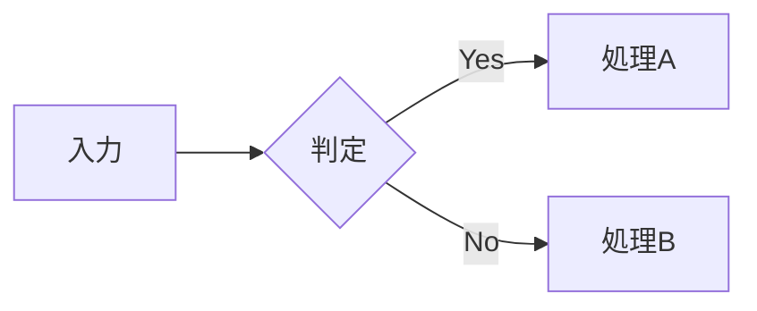

# Markdown 記法スニペット集

:::{.chapter-lead}
Vivlio Starter で使える記法を、コピーしてそのまま使える形で並べた見本帳です。「あの記法、どう書くのだったか」と思ったときに開き、使いたい例を原稿へ写して、中身だけを書き換えてください。並びはガイドブックの付録「記法早見表」と同じです。細かな決まりは、早見表から各解説章をたどれます。
:::

:::{.notice}
このファイルは**見本**です。原稿ではないので `config/catalog.yml` には登録されておらず、ビルドの対象にもなりません。中に出てくる画像（`image.png` など）やコード（`sample.rb` など）も実在しないので、コピーしたら自分のファイル名へ置き換えてください。
:::

## 文章の基本

見出しは行頭の `#` の数（1〜6）でレベルを決めます。`#` は章題、`##` は節、`###` は項です。

**太字**、*斜体*、~~取り消し線~~、`インラインコード`

ルビ: {相対性理論|そうたいせいりろん}

キーボードのキー: 保存は 〘Ctrl〙 + 〘S〙 で行います。`<kbd>Ctrl + S</kbd>` と書いても同じです。

行末で改行すると、紙面でもそこで改行されます。
この行は、前の行の次の行に組まれます。

段落は空行で区切ります。

記号をそのまま表示する: \*アスタリスク\*、\`バッククォート\`、\# ハッシュ

改ページは `---` だけの行を置きます（下の例は見本なのでフェンスの中に入れています）。

```markdown
---
```

## リスト

箇条書き（字下げで入れ子。マーカーは ● ○ ・ と変わります）:

- 項目 1
- 項目 2
  - 子項目 1
  - 子項目 2

番号付きリスト:

1. 最初の項目
2. 2 番目の項目
   1. 子項目 1
   2. 子項目 2

英字・ローマ数字の番号（fancy list。最初の項目のマーカーで形式が決まります）:

a. 小英字のリスト
b. 二番目の項目

(1) 括弧付き数字
(2) 二番目の項目

i) 小ローマ数字の片括弧
ii) 二番目の項目

チェックボックス付きの一覧（タスクリスト）:

- [ ] 図版を用意する
- [x] 原稿を書き終える

複合番号（1.1 / 1.2）:

:::{.outline-list}
1. 概要
   1. この機能について
   2. インストール方法
2. 使い方
:::

用語と説明（定義リスト）:

用語 1
: 用語 1 の説明をここに書きます。
  説明が長いときは、半角空白で字下げして次の行に続けます。

用語 2
: 一つの用語に複数の語義があるときは、`: ` の行を並べます。
: 二つめの語義です。

▶ 付きの補足リスト（青コメ）:

- ▶ ポイント解説をここに書きます
- ▶ 補足情報をここに書きます

❶ 付きの手順リスト（赤コメ）:

- ❶ 最初の手順
- ❷ 次の手順
- ❸ 最後の手順

## コードとターミナル

コードブロックは、言語名を添えると色分けと行番号が付きます:

```ruby
def greet(name)
  "こんにちは、#{name}さん!"
end
```

ファイル名を表示する:

```ruby:hello.rb
def greet(name)
  "こんにちは、#{name}さん!"
end
```

行番号を途中（5 行目）から始める:

```ruby:excerpt.rb#L5
def hello
end
```

`codes/` のファイルを取り込む（2 行目は 10〜17 行目だけ）:

```include:sample.rb```

```include:prime.rb:10-17```

コメント行を強調する（`[!]` を書いたコメントが赤くなります）:

```ruby
def greet(name)
  puts "Hello, #{name}!"   # [!] この行が強調される
  puts "Goodbye!"           # 通常のコメント
end
```

コードの中にコードのフェンスを書く（外側をチルダか、バッククォート 4 つにします）:

~~~markdown
```ruby
puts "Hello"
```
~~~

ターミナルへの入力:

:::{.terminal}
$ vs build
$ cp *.png *.bak
:::

実行結果・出力例:

:::{.output}
✅ ビルドが完了しました
:::

コードと表示例を左右に並べる（外側のコロンを、中の囲みより多くします）:

::::{.side-by-side}
```markdown
- ▶ ここはポイント解説
- ▶ ここは補足
```

:::{.output}
- ▶ ここはポイント解説
- ▶ ここは補足
:::
::::

## 表

| 左揃え | 中央揃え | 右揃え |
| :--- | :---: | ---: |
| テキスト | テキスト | 123 |
| テキスト | テキスト | 456 |

横結合（`||`）と複数行のヘッダー:

|          |       結合       ||
| ヘッダー1 | ヘッダー2 | ヘッダー3 |
| :------- | :------: | -------: |
| セル1     |      長いセル      ||
| セル2     |  中央寄せ  |   右寄せ  |

セルの中の縦棒は、バックスラッシュでエスケープします:

| 書き方 | 意味 |
| :--- | :--- |
| `a \| b` | a または b |

見出しの行を出さない表（見出しの行のセルをすべて空にします）:

| | |
| :--- | :--- |
| 左の列 | 右の列 |

行の多い長い表:

:::{.long-table}
| 縦に長い表 | 説明 |
| :--- | :--- |
| 項目 1 | 説明 1 |
| 項目 2 | 説明 2 |
:::

横に広い表を回転する（`scale`・`shift-y` は自動で決まります。合わないときだけ書きます）:

:::{.rotate-table scale=60% shift-y=10%}
| 列1 | 列2 | 列3 | 列4 | 列5 |
| --- | --- | --- | --- | --- |
| ... | ... | ... | ... | ... |
:::

## 画像・図

1 行に単独で書くと、代替テキストが画像の下のキャプションになります:


文の途中に  を置くと、キャプションは付きません。

幅と配置:

{width=50% align=center}

キャプションと図番号を付ける（画像の直前の行に書きます）:

** 図のタイトル @sample-fig **
{width=60%}

周囲を切り落とす（上・右・下・左の時計回り。一つなら四辺共通）:

{crop="30 100"}

余白を詰めて大きく載せる:

{trim=on}

枠を外す（単独で置いた画像には、既定で枠が付きます）:

{border=off}

写真をグリッドで並べる:

:::{.pictures}


:::

画像を 2 枚横に並べる（幅の比も決められます）:

:::{.image-group}
{width=40%}

:::

画像と本文を横に並べる（`.img-text2`・`.img-text3` は本文側が 2 倍・3 倍の幅。`.text-img`・`.text2-img`・`.text3-img` は左右が逆）:

:::{.img-text}

画像の右側に配置されるテキストです。
:::

:::{.text2-img}
テキストが左側で、画像の 2 倍の幅になります。

:::

画像と本文の間の余白（`.gap-s`・`.gap-m`・`.gap-l`）:

:::{.img-text .gap-l}

大きな余白を空けます。
:::

本文を画像に回り込ませる:

:::{.sideimage-right}

画像の左側にテキストが回り込みます。
:::

:::{.sideimage-left}

画像の右側にテキストが回り込みます。
:::

スクリーンショットに注釈を描く（座標は画像の左上が 0, 0、右下が 1000, 1000 の千分率。`530px` のように実寸でも書けます）:

:::{.showcase}

# 行頭が # の行はコメントです（出力されません）
rect:1 530, 335, 175, 165 {pos=bottom} 囲んだ部分の説明
pointer:2 490, 130 {label="ここ"} 指し示したい箇所
:::

罫線図・アスキーアート:

:::{.diagram}
```
       A
     ┌─┴─┐
     B    C
```
:::

フローチャートなどの図（mermaid）:



## リンク・脚注・数式

リンク: [リンクテキスト](https://example.com)

URL をそのままリンクにする: <https://example.com>

同じ URL を何度も使う（参照リンク）: [リンクテキスト][ref]

[ref]: https://example.com

脚注: 本文に脚注を付けます[^note]。短い補足はその場に書けます^[これはインライン脚注です。]。

[^note]: 脚注の内容をここに書きます。

インライン数式: $E = mc^2$

ディスプレイ数式（`$$` で囲みます。複数行に分けて書けます）:

$$
\gamma = \frac{1}{\sqrt{1 - \dfrac{v^2}{c^2}}}
$$

数式は LaTeX を使わず、見たままでも書けます: x² + y² = r²、√(x+1)、Σx²

数式だと明示する（中身を判定せず、ディスプレイ数式として組みます）:

```math
F = ma
p = mv
```

数式をコードのまま見せる（バッククォートを 2 つ重ねます）: ``√n``

## 囲み枠・注記

:::{.section-lead}
節の冒頭に置く導入文です（章の冒頭なら `:::{.chapter-lead}`）。この節で扱うことを数行で示します。
:::

:::{.column}
**コラムの見出し**

本文の流れから少し外れた話題や、豆知識を書きます。
:::

:::{.memo}
覚え書きや、本文の補足メモを書きます。
:::

:::{.tip}
知っておくと役に立つコツを書きます。
:::

:::{.note}
本文の補足説明を書きます。上下の罫線で区切られます。
:::

:::{.notice}
先に伝えておかないと困る、重要な注意点を書きます。
:::

:::{.small}
本文の理解には必須ではない、細かな注意点や背景を小さめに組みます。
:::

1 段落だけなら、段落の末尾に書けます。{.small}

:::{.references}
**参考資料**

- 著者名『書名』出版社、2024 年
- 写真提供: 提供元の名前
:::

書籍紹介カード（書名の後の段落が二つあれば、最初の段落が書誌になります）:

:::{.book-card}

**書籍のタイトル**
著者名 著
出版社・2024 年

書籍の説明文をここに書きます。
:::

会話文（話者は `config/talk.yml` にキーで登録します）:

:::{.talk}
haruka: 行頭の「キー: 」で話者が切り替わります。
mirai: 字下げした行は、直前の発話の続きになります。
       このように続けて書けます。
:::

表示はブロックごとに切り替えられます（`style=inline`・`name=off`・`avatar=off`）:

:::{.talk style=inline}
haruka: 「名前：発話」の 1 段落で組みます。
mirai: 小説や脚本のような対話に向きます。
:::

`config/talk.yml` の話者の定義:

```yaml
haruka:
  name: 遙香            # 表示名（省略時はキーをそのまま表示）
  color: red           # テーマ色名 / HEX
  avatar: haruka.webp  # images/characters/ のファイル名。auto なら頭の字の簡易アバター
  initial: 遙          # 簡易アバターに入れる字（1〜2 文字。省略時は表示名の頭の字）
  avatar_size: 15mm    # アバターの直径（省略時は display: の値）
  side: left           # left / right

display:
  style: chat          # chat（吹き出し）/ inline（「名前：発話」の 1 段落）
  name: true           # 話者名を表示する
  avatar: on           # アバターを表示する
```

## レイアウト・余白

ブロックごと寄せる:

:::{.align-center}
中央に寄せたブロックです（`.align-left`・`.align-right` も）。
:::

文字の揃えだけ変える（段落の末尾に書きます。`.text-left`・`.text-center` も）:

右に揃えた段落です。{.text-right}

二段組:

:::{.text-2dan}
二段組で組まれるテキストです。長い文章や箇条書きを、紙面を効率よく使って並べられます。
:::

段落の下に余白を空ける（`{.aki}` は 1 行分、`{.aki2}` は 2 行分）:

少し間を空けたい段落です。{.aki}

余白の微調整（負の値で詰めます。単位は `lh`・`mm` など）:

@vspace:1.5lh

行の頭を下げる（単位を省くと全角の文字数）:

@hspace:2 行頭を 2 文字ぶん下げます。

改ページ（`---` と同じ）と、右ページ（左ページなら `:verso`）からの改ページ:

```markdown
@pagebreak

@pagebreak:recto
```

クラスを組み合わせる:

:::{.column .align-center}
中央に寄せたコラムです。
:::

独自の装飾を作る（クラス名を付け、`stylesheets/custom.css` に `.myclass { ... }` を書きます）:

:::{.myclass}
独自のクラスを付けたブロックです。
:::

## 参照・索引・データ

図・表・コードに番号を付ける（タイトルの末尾に `@ラベル`）:

** サンプルコード @sample-code **
```ruby
def hello(name)
  puts "Hello, #{name}!"
end
```

** データ表 @data-table **
| 項目 | 値 |
| :--- | ---: |
| A | 100 |
| B | 200 |

見出しにラベルを付ける（紙面には出ません）:

```markdown
## インストール @install
```

参照する: 本文に @sample-code と書くと「リスト 1-1」に、@data-table は「表 1-1」に、@sample-fig は「図 1-1」に、@install は「インストール」になります。ページ番号を添えるなら @pageref:install です（PDF では「（p.200）」が付き、EPUB では省かれます）。

章を参照する（ファイル名のスラッグに `ch-` を付けたものが、その章のラベルです）: 詳しくは @chapref:ch-build を参照してください。章題だけなら @ch-build と書きます。

書名・版数・日付を差し込む: 『@title』v@version（@today 更新）

QR コード（既定は 18mm 角。大きさを変えるなら直後に `{width=25mm}`）: @qr:https://github.com/Atelier-Mirai/vivlio-starter

索引・用語集に登録する（読みは省けます。ルビの `{単語|読み}` と混同しないでください）: [相対性理論|そうたいせいりろん]、[Ruby]

索引の候補は `vs index:auto` で原稿から集め、確かめてから `vs index:apply` で登録できます。

データを展開する（`data/books.yml` を `templates/_book.md` で整形します）:

```markdown
= books                    # 全件
= books | tags=ruby        # タグで絞り込み
= books | -year | 3        # 年の新しい順に 3 件
= book  | タイトル名       # 1 件だけ
```

`data/books.yml` の例:

```yaml
- title: 書籍のタイトル
  author:
    name: 著者名
  publisher: 出版社
  year: 2024
  desc: 書籍の説明文。
  cover: cover.webp
  tags: [ruby, programming]
```

`templates/_book.md` の例（`=` とキー名の間には半角空白が要ります。値の無い項目は、その部分だけが消えます）:

```markdown
:::{.book-card}

**= title**
= author.name 著／= publisher／= year 年

= desc
:::
```
